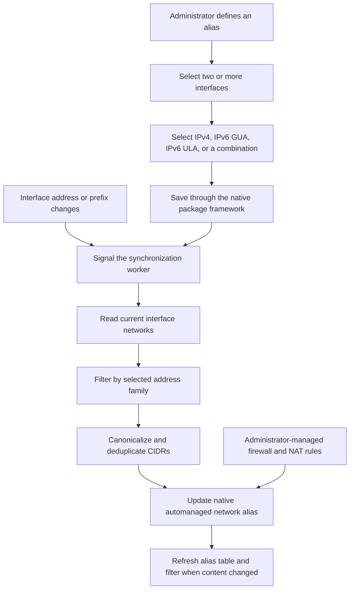

# Dynamic Networks Alias

Copyright © 2026 gebra

Contact: [projects@gbrands.de](mailto:projects@gbrands.de)

License: Apache License 2.0

Dynamic Networks Alias is a native pfSense package that combines the current
networks of multiple interfaces into stable firewall aliases. It is a spin-off
from [DynGUA-PD](https://github.com/gebra-de/pfSense-Dyn-GUA-Delegation), where
native automatically managed aliases were first used for delegated prefixes.

> **Project status:** Version 1.0.0 for pfSense CE 2.9.0. The release provides
> guarded migration from interface groups and automatic refresh after native
> interface address and prefix events.

## Goals

- Create administrator-defined aggregate aliases from two or more interfaces.
- Follow dynamic IPv4 networks, IPv6 GUA prefixes and IPv6 ULA prefixes.
- Support multiple simultaneous networks on an interface.
- Keep firewall and NAT rule design under administrator control.
- Avoid interface groups used only to combine network objects.
- Preserve rule references when a dynamic network is temporarily unavailable.

## Workflow



## Web Interface

Open **Firewall > Auto Alias**. Select **Add**, enter a stable native alias
name, choose the address classes, and select at least two interfaces. Hold
Ctrl on Windows or Linux, or Command on macOS, to select multiple entries.

| Field | Purpose |
| --- | --- |
| **Alias Name** | Sets the stable native pfSense alias name. |
| **Address Family** | Selects IPv4, IPv6 GUA, IPv6 ULA, or a supported combination. |
| **Interfaces** | Selects two or more source interfaces. Loopback is excluded. |

Saving a definition creates or updates an ordinary native network alias. It
does not create firewall or NAT rules. Administrators use the resulting alias
wherever pfSense accepts a network alias.

## Address Selection

IPv6 definitions can include global unicast address (GUA) prefixes from
`2000::/3`, unique local address (ULA) prefixes from `fc00::/7`, or both.
Link-local, loopback,
multicast, and unusable addresses are excluded. IPv4 uses each active interface
network instead of its individual host address.

The package supports IPv4, GUA, ULA, IPv4 with GUA, IPv4 with ULA, GUA with
ULA, and all three address classes. Firewall rules still need an address family
compatible with their use.

## Migrating from Interface Groups

Use a name for the Dynamic Networks Alias that is different from every existing
interface group. pfSense treats interface-group names as reserved system aliases,
and firewall rules store them as interface `network` references instead of regular
alias `address` references. Auto Alias rejects reserved names to prevent that
ambiguity.

For each affected firewall or NAT rule, select the new Auto Alias, save the rule,
and apply the pending changes before deleting the interface group. Then delete the
interface group and apply the pending changes again. Verify the resulting rules.

pfSense does not rebuild the filter automatically when an interface group is
deleted. If a migrated rule appears invalid afterward, open it, select the Auto
Alias again, save the rule, and apply the pending changes. This writes the native
`address` reference and rebuilds the filter. Auto Alias deliberately does not edit
administrator-owned firewall or NAT rules.

## Alias Ownership and Safety

Each generated object is a native `network` alias with the `automanaged` tag,
the administrator-selected name, and a description such as
`Managed by Auto Alias; content: LAN net, OPT1 net`.

- Foreign aliases are never adopted or overwritten.
- An exact package-owned alias is reclaimed safely after an upgrade.
- Empty dynamic results fail closed by retaining an empty alias.
- Referenced aliases remain present so firewall and NAT rules do not break.
- Alias and filter reloads occur only after content changes.
- Configuration writes are serialized.
- Generated CIDRs are validated and canonicalized before persistence.
- Package removal preserves aliases referenced by existing rules.
- Core pfSense files are not patched.

## Automatic Synchronization

Saving, editing, or deleting a definition signals a separate synchronization
worker. Native interface and prefix reload events signal the same worker.
Repeated events are coalesced, and a bounded retry window allows dynamic
addresses to settle after boot or an interface restart before aliases and the
filter are refreshed.

Automatic synchronization was verified during live DHCPv6-PD and Track6
prefix changes on pfSense CE 2.9.0.

## Development Standards

The project uses the native pfSense package framework and follows Netgate's
[pfSense Developer Style Guide](https://docs.netgate.com/pfsense/en/latest/references/developer-style-guide.html)
and
[Typographic Conventions](https://docs.netgate.com/pfsense/en/latest/references/typographic-conventions.html).

## Installation

Download the package and checksum from the signed `v1.0.0` GitHub release.
Verify the checksum before transferring the package to pfSense:

```sh
sha256 pfSense-pkg-dynnetalias-1.0.0.pkg
pkg add -f ./pfSense-pkg-dynnetalias-1.0.0.pkg
```

Back up the pfSense configuration before installing the package. See
[`BUILD.md`](BUILD.md) to validate and build the package from source.

## Current Limitations

- Only configured and currently observable interface networks can be included.
- A temporarily unavailable network leaves the managed alias empty until a
  later native event or package resynchronization discovers it.
- Firewall and NAT rules remain entirely under administrator control.

## License

Dynamic Networks Alias is licensed under the Apache License, Version 2.0. See
the complete license text in [`LICENSE`](LICENSE).
