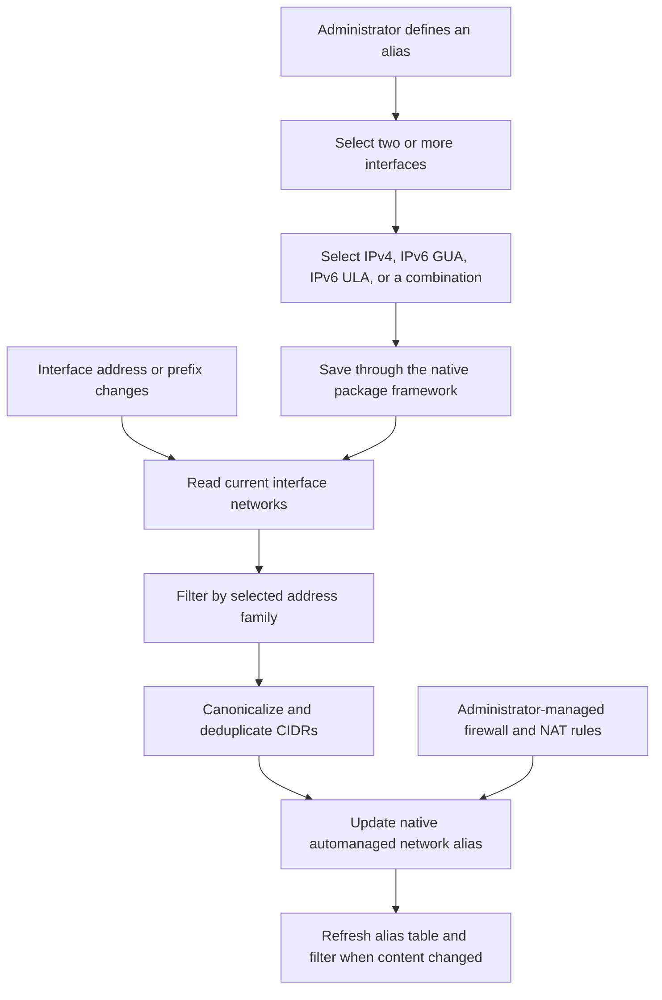

# Dynamic Networks Alias

Dynamic Networks Alias is a native pfSense package that combines the current
networks of multiple interfaces into stable firewall aliases.

The project addresses a practical limitation with multiple dynamic IPv6 GUA
networks. It is a spin-off from [DynGUA-PD](https://github.com/gebra-de/pfSense-Dyn-GUA-Delegation), where native automatically managed aliases were first used for delegated prefixes.

Interface groups can combine interfaces for policy management, but
they also create additional tabs under **Firewall > Rules**. This package keeps
rule organization unchanged by maintaining ordinary native network aliases.

> **Status:** Version 0.2.0 is the first beta release candidate. Automatic
> synchronization has been verified during a live DHCPv6-PD and Track6 prefix
> transition triggered through the native pfSense interface lifecycle.

## Goals

- Create administrator-defined aggregate aliases from two or more interfaces.
- Follow dynamic IPv4 networks, IPv6 GUA prefixes, and IPv6 ULA prefixes automatically.
- Support multiple simultaneous networks on an interface.
- Write aliases through native pfSense configuration and alias functions.
- Keep firewall and NAT rule design under administrator control.
- Avoid interface groups when they are needed only to combine network objects.
- Preserve rule references when a dynamic network is temporarily unavailable.

## Workflow



## Alias Ownership

Each generated object is a native pfSense alias with:

- type `network`
- tag `automanaged`
- a stable administrator-selected name
- a description such as
  `Managed by Auto Alias; content: LAN net, OPT1 net`

The package will refuse to overwrite an alias it does not own. If a referenced
managed alias temporarily has no usable networks, it remains present and empty
so existing firewall rules do not contain broken references. Deleting a
definition removes its alias only when the alias is no longer referenced.

## Address Selection

For IPv6, definitions can include Global Unicast Address networks from `2000::/3`, Unique Local Address networks from `fc00::/7`, or both. Link-local, loopback, multicast, and unusable addresses are excluded. Each unique active network is included once.

IPv4 support uses the active interface network rather than the individual host address. Definitions may combine IPv4, GUA, and ULA networks, but firewall rules still need an address family compatible with their use.

## Web Interface

The package appears under **Firewall > Auto Alias**. Each definition contains:

| Field | Purpose |
| --- | --- |
| **Alias Name** | Sets the stable native pfSense alias name. |
| **Address Family** | Selects IPv4, IPv6 GUA, IPv6 ULA, or any supported combination. |
| **Interfaces** | Selects two or more source interfaces. |

Saving a definition does not create firewall or NAT rules. Administrators use
the resulting alias wherever a native network alias is accepted.

## Safety Model

- Foreign aliases are never adopted or overwritten.
- Empty dynamic results fail closed by producing an empty alias.
- Alias and filter reloads occur only after a real content change.
- Configuration writes are serialized.
- Generated CIDRs are validated and canonicalized before persistence.
- Package removal does not break references in existing rules.
- Core pfSense files are not patched.

## Native Integration

The implementation uses the pfSense package framework, configured-interface
APIs, native alias tags, alias reference checks, alias table generation, and
filter configuration routines. Saving, editing, or deleting a definition
signals the synchronization worker. Native interface and prefix changes invoke
the same worker through the pfSense package reload event. Repeated events are
coalesced before aliases and filters are updated.

The project follows Netgate's
[pfSense Developer Style Guide](https://docs.netgate.com/pfsense/en/latest/references/developer-style-guide.html)
and
[Typographic Conventions](https://docs.netgate.com/pfsense/en/latest/references/typographic-conventions.html).

## Package Layout

```text
Makefile
pkg-descr
pkg-plist
files/pkg-install.in
files/pkg-deinstall.in
files/usr/local/pkg/dynnetalias.xml
files/usr/local/pkg/dynnetalias.inc
files/usr/local/libexec/dynnetalias_worker.php
files/usr/local/share/pfSense-pkg-dynnetalias/info.xml
```

The event worker is a separate process entry point because native interface
reloads must not perform package writes while holding network-service locks.

## License

Copyright © 2026 gebra

Licensed under the Apache License, Version 2.0. See [`LICENSE`](LICENSE).
